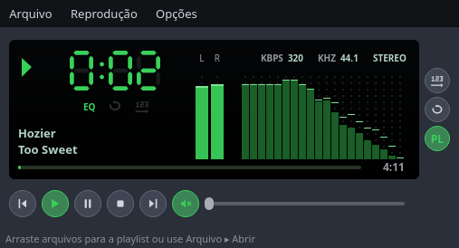
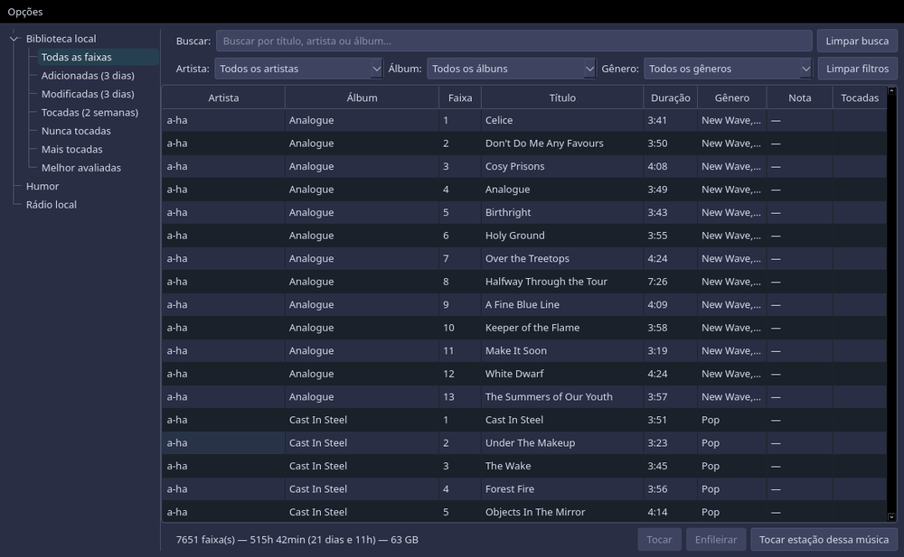
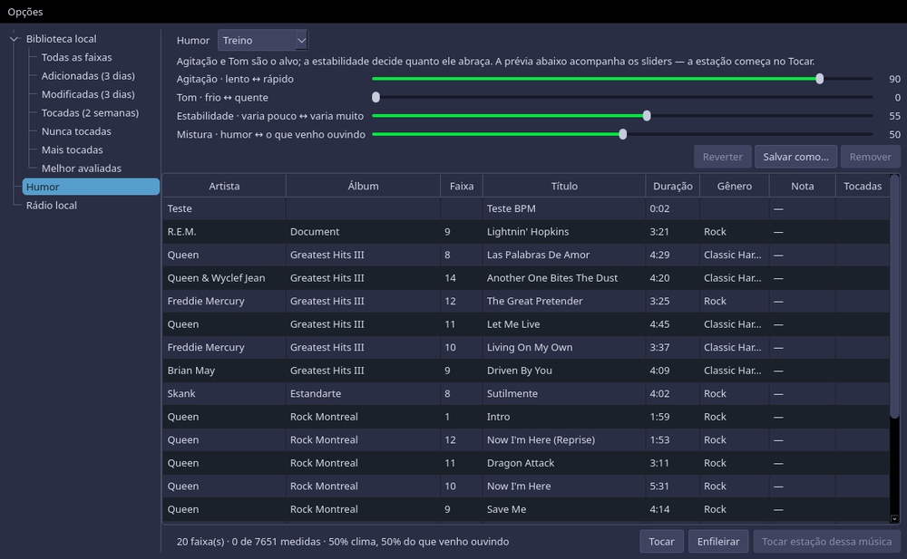
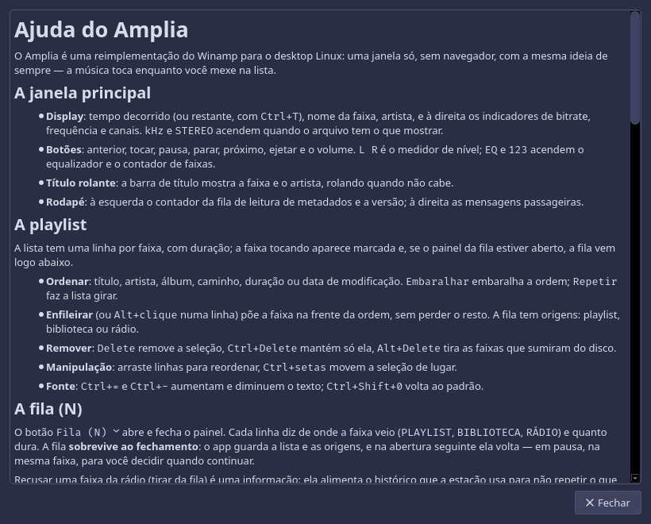
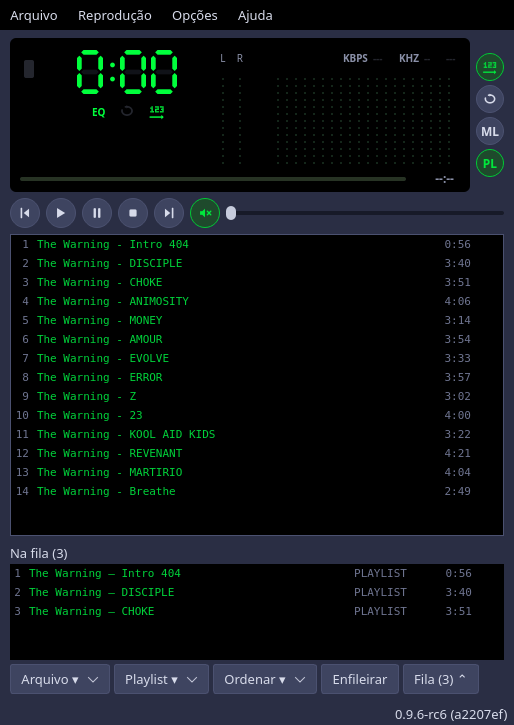

# Amplia

Português · [English](#english)

> **Um novo player de música!** Inspirado na alma do Winamp, que busca ir mais longe, ser
> comunitário e colaborativo.

Player de áudio nativo para Linux, escrito em C++ com Qt 6 — playlist, fila, equalizador de 10 bandas, visualizador, scrobbling e controle de mídia, sem camada de emulação.

## Motivação e histórico

Uso o Winamp há mais de vinte anos. Ele faz coisas que nenhum player moderno entrega com a mesma competência (na minha opinião):
fila separada da playlist, o sorteio com nível, o display de tempo condensado com visualizador de picos de volume e visualização de bandas, o jeito de saltar para uma faixa digitando parte do nome. Tudo o que existe hoje é limitado e/ou burocrático demais ou exige Wine, então resolvi "modernizar" justamente o que eu gostava.

Em setembro de 2024 a Llama Group abriu o código-fonte do Winamp, mas sob uma licença que proíbe distribuir versões modificadas — ou seja, um port direto não pode ser publicado a partir dele.
Então a saída foi outra: usar o comportamento como **especificação** e escrever o player do zero, nativo, em C++ com Qt 6, PipeWire e FFmpeg. Nenhum arquivo do fonte original entrou neste repositório.

O código foi escrito em parceria com um agente de IA (DeepSeek, através do DeepSeek Harness para Linux): eu definia o comportamento, revisava cada tela, testava com a minha biblioteca e decidia o que entrava ou seria repriorizado. As decisões de projeto, o escopo, os testes de aceitação e este README são meus. O registro de como o projeto foi construído está em [`docs/NOTAS-DE-SESSAO.md`](docs/NOTAS-DE-SESSAO.md).

> **Sobre a origem do código:** não há cópia direta de código de fontes conhecidas.
> Bibliotecas entram por linkagem (Qt, FFmpeg, TagLib, libsystemd, SQLite), e o código do Winamp serviu como referência de **comportamento e formato**, nunca como fonte. Mas como parte deste projeto foi escrita por um agente de IA, treinado com as mais diversas fontes, sob as quais eu não tenho controle — então é possível que algum trecho reproduza, sem intenção, uma solução que já exista em outro lugar. Se você reconhecer um trecho assim, abra uma issue: a correção ou a atribuição é feita tão logo quanto possível.

> O Amplia é um projeto independente. Não tem vínculo com a Nullsoft, com a Winamp ou com a Llama Group, e não distribui código do Winamp nem artefatos da marca. O nome, a interface e os recursos são originais; a compatibilidade com formatos e hábitos de teclado é intencional.



| Biblioteca | Humor | Ajuda (F1) |
|---|---|---|
|  |  |  |

## Estado

**Versão 1.0.0 (`v1.0.0`)** — a primeira versão **estável**. A biblioteca **sobrevive a
mudança de esquema** (o banco tem número de versão e migra sozinho, sem perder linha), as
correções da auditoria externa estão dentro (a rádio distingue tom relativo de paralelo, o I/O
do motor saiu de baixo do mutex de estado e as esperas de rede do scrobbling têm teto de
tempo), e entram os 22 ajustes de uso: colunas Pulos e Ano, ordem por ano/álbum/faixa,
estrelas sempre visíveis, gêneros multivalorados quebrados por termo, estação com cota por
artista e reposição, prévia longa com o motivo de cada faixa, progresso da análise e o bloco
"Como a rádio aprende". As builds
publicadas ficam em [Releases](https://github.com/cassiofiorin/Amplia/releases); o pacote é
instalável sem compilar (veja [Instalar o pacote pronto](#instalar-o-pacote-pronto)).

A Biblioteca está fechada: varredura incremental (só o arquivo novo ou alterado é
reaberto), filtros de artista/álbum/gênero que combinam com a busca, árvore de visões,
estrelas e playcount. A capa de álbum saiu para a **F3.1**, depois deste README — é
cosmética e não muda achar música — em 26/11 ela foi absorvida pela **F4**, porque ler a capa é
leitura de tag e o autotag é escrita de tag.

**Instalar fora do Flatpak não é requisito do 1.0.** O alvo é o Fedora Atomic/Bazzite, onde
Flatpak é o caminho normal; AppImage, `.deb`, `.rpm` e o port para **Windows** continuam na
**F7**, como evolução da solução, não como porta de entrada.

| Fase | Entrega | Situação |
|---|---|---|
| F0 | Primeiro som nativo (decode + PipeWire + janela mínima) | **concluída** |
| F1a | Player e playlist (fila, sorteio, `.m3u`, metadados) | **concluída** |
| F1b | Integração (gapless, MPRIS2, Last.fm, ListenBrainz) | **concluída** — validada no uso real |
| F1c | Formatos e última milha (`.pls`, `.b4s`, `.wpl`, pastas, sessão, colunas, capa de pasta) | **concluída** |
| F2 | Equalizador de 10 bandas, presets `.eqf`, ReplayGain, curva | **concluída** |
| F2B | Display do player (relógio de 7 segmentos, LEDs, transporte) | **concluída** |
| F2C | Visualização (medidor L/R, espectro, beat, calibração de fps) | **concluída** |
| F2D | Janelas (playlist e equalizador em janela própria) | **concluída** |
| F2E | Aparência (esquemas de cor, editor de quatro cores, CSV) | **concluída** |
| F5 | Atalhos (paridade de teclado com o original) | **concluída** |
| F6a/b | Idioma (infraestrutura e inglês completo) | **concluída** |
| F3 | Biblioteca SQLite: árvore, busca, filtros, varredura incremental, estrelas, playcount | **concluída** |
| F4 | Tags, capa e identidade: autotag por AcoustID/MusicBrainz, gravação de tags, capa, fingerprint | próxima |
| F5 | Análises compartilhadas: BPM e tom por obra, exportar e importar | planejada |
| F6 | Perfis compartilhados: humor, mistura e léxico com nome e autor | planejada |
| F6c | Documentação pública (este README bilíngue, `NOTICE`) | **concluída** |
| F7 | Empacotamento e alcance: AppImage, `.deb`, `.rpm`, portátil, Flathub e Windows | planejada |
| F8 | Skins clássicas `.wsz` (a comunidade pode assumir) | fim da fila |
| F9 | Plugins `.so` (DSP/visualização) | adiada |
| F2D.1 | Acoplamento de janelas (só X11) | avaliado, não planejado |
| RC1 | Primeiro pacote público (`v0.1.0-rc1`) | **publicada** |
| 0.9.1 | Fila, Humor, Rádio local, Ajuda bilíngue; menu e arrasto na Biblioteca (`v0.9.1`) | publicado |
| 0.9.3-rc3 | Reordenar arrastando (playlist e fila), fila vazia que abre, playlist → fila (`v0.9.3-rc3`) | superada pela rc4 |
| 0.9.4-rc4 | Arrasto sem duplicar, drop na posição, cursor de mover (`v0.9.4-rc4`) | superada pela rc5 |
| 0.9.5-rc5 | Biblioteca completa: varredura incremental por mtime e filtros de artista/álbum/gênero (`v0.9.5-rc5`) | superada pela rc6 |
| 0.9.6-rc6 | Inglês completo: 178 textos que faltavam, inclusive a janela da Biblioteca (`v0.9.6-rc6`) | superada pela rc7 |
| 0.9.7-rc7 | Última antes do 1.0: esquema da biblioteca versionado, correções da auditoria, volume alinhado ao contador (`v0.9.7-rc7`) | superada pela 1.0.0 |
| 1.0.0 | Primeira versão estável: biblioteca com esquema versionado, 22 ajustes de uso, estação com cota e reposição (`v1.0.0`) | **estável** |

Cada fase concluída sai numa versão com **todos os formatos de empacotamento** disponíveis
(hoje só Flatpak; a F7 cria AppImage, `.deb`, `.rpm`, o portátil e o Windows).

O que já funciona está descrito em [**O que funciona hoje**](#o-que-funciona-hoje), mais
abaixo. O detalhe de cada decisão está em [`docs/DECISIONS.md`](docs/DECISIONS.md) e o
plano em [`docs/ROADMAP.md`](docs/ROADMAP.md).

## Instalar o pacote pronto

A release traz um bundle Flatpak (`Amplia-<versão>-x86_64.flatpak`). Ele roda no runtime do
KDE, que o próprio `flatpak` baixa do Flathub na primeira instalação. É o formato de suporte
do projeto: Bazzite e Fedora Atomic (o alvo original), e qualquer distro com Flatpak. Quem
prefere compilar tem o [Como compilar](#como-compilar); os outros formatos vêm na F7.

```bash
# 1. baixe o bundle da release (ou use a página de Releases)
curl -LO https://github.com/cassiofiorin/Amplia/releases/download/v1.0.0/Amplia-1.0.0-x86_64.flatpak

# 2. instale só para o seu usuário
flatpak install --user ./Amplia-1.0.0-x86_64.flatpak

# 3. rode
flatpak run io.github.cassiofiorin.Amplia
```

Para atualizar, instale o bundle novo por cima; para remover,
`flatpak uninstall --user io.github.cassiofiorin.Amplia`. Os dados do app (banco da
biblioteca, preferências) ficam em `~/.var/app/io.github.cassiofiorin.Amplia/` e
sobrevivem à atualização.

## Como compilar

O alvo de build é o SDK do KDE, que já traz Qt 6, FFmpeg e PipeWire — não é preciso
instalar nada de desenvolvimento no host.

```bash
# 1. runtime e SDK (uma vez, ~3 GB na instalação de usuário)
flatpak install --user flathub org.kde.Sdk//6.10

# 2. build + instalação local
cd wamp
./scripts/build-flatpak.sh

# 3. executar (abre a janela; passe um arquivo para tocar na hora)
flatpak run io.github.cassiofiorin.Amplia ~/Música/alguma-faixa.mp3
```

### Sobre o `flatpak-builder`

O `org.flatpak.Builder` **não serve** neste caso: rodando dentro do seu sandbox, ele
consulta o SDK via portal do host com um ambiente em que a instalação de usuário do
Flatpak não aparece, e falha com `Unable to find sdk org.kde.Sdk version 6.10` —
mesmo com `flatpak info org.kde.Sdk//6.10` funcionando no host. Use o binário do
host, um dos dois caminhos:

```bash
# caminho normal, com root
sudo dnf install flatpak-builder

# alternativa sem root: extrair o RPM em ~/.local/share/amplia-tools
mkdir -p /tmp/fpb && cd /tmp/fpb
dnf download flatpak-builder
mkdir -p root && cd root && rpm2cpio ../flatpak-builder-*.rpm | cpio -idm --quiet
mkdir -p ~/.local/share/amplia-tools
cp -r /tmp/fpb/root ~/.local/share/amplia-tools/flatpak-builder
```

O script procura, nesta ordem: `$FLATPAK_BUILDER_BIN`, `flatpak-builder` no `PATH`,
o binário extraído em `~/.local/share/amplia-tools/flatpak-builder/usr/bin/` e, por
último, o app `org.flatpak.Builder` (com aviso).

Artefatos de build ficam em `~/.cache/amplia-build` (fora do repositório, porque o
manifest usa `type: dir` e copiaria qualquer lixo junto).

## O que funciona hoje

Sorteio, repetir e `PL` ficam empilhados à direita do display, como os botões `PL`/`ML` da
skin clássica; a linha de transporte fica só com os controles e o volume, que ocupa a largura
livre. O botão `PL` abre o editor de playlist em **janela própria**: o player não muda de
tamanho, e fechar a lista só a esconde. (No Wayland o compositor pode listar essa janela
também na barra de tarefas — limitação do protocolo, ver [Limites](#limites-conhecidos).)
Duplo clique toca uma faixa. Arrastar arquivos para a janela
(ou usar `Adicionar…`) apenas **organiza** a lista: nada começa a tocar sozinho — o
primeiro item fica carregado em pausa, pronto para o `Play`. Quem abre por `Abrir…`, pela
linha de comando ou por duplo clique escolheu tocar, e toca. `wamp --playlist` já abre com
a lista à mostra. Tamanho e estado da lista ficam guardados na INI; no Wayland a posição
da janela é do compositor, então só o tamanho volta.

Atalhos no estilo Winamp: `Z` anterior, `X` toca, `C` pausa, `V` para, `B` próxima,
`Espaço` alterna play/pause, `S` liga/desliga o sorteio, `Ctrl+P` preferências.
No padrão do Playlist Editor: `L` adiciona arquivo(s), `Shift+L` adiciona pasta,
`Ctrl+O` abre playlist, `Ctrl+N` começa uma nova, `Ctrl+S` salva `.m3u`,
`Alt+3` abre o **File Info**, `,` abre o **Jump to File**.

O rodapé da lista tem três menus, como o Playlist Editor: **Arquivo ▾** (nova, abrir,
adicionar arquivo/pasta, salvar), **Playlist ▾** (selecionar tudo/nada, inverter,
remover, manter só a seleção, limpar, remover inexistentes) e **Ordenar ▾** (por
título, por nome de arquivo, por caminho, inverter lista, embaralhar lista) — com os
mesmos atalhos do Winamp (`Ctrl+Shift+1..3`, `Ctrl+R`, `Ctrl+Shift+R`). Ordenar fica
bloqueado enquanto a leitura de tags ainda está na fila, porque a ordem por título
mudaria por baixo.

O sorteio tem nível (0–100%) em **Opções ▸ Preferências…**, como o *shuffle morph rate*
do Winamp: 0% segue a ordem da lista, 100% sorteia por toda a playlist e os valores do
meio sorteiam dentro de um trecho à frente, sem repetir a faixa atual nem as últimas que
tocaram. Botão `⇄` na barra de transporte liga e desliga.

Na lista, `Enter` toca a faixa selecionada e `Delete` remove; `Alt+clique esquerdo`
enfileira (de novo, tira da fila) e clique direito abre o menu com reproduzir, enfileirar
e remover. *Limpar playlist* pede confirmação, porque um clique acidental ali custa a
lista inteira.

Os sliders de posição e de volume pulam para onde você clica (não só arrastando o
indicador): clique posiciona, arraste continua de onde clicou.

Dá para soltar arquivos em qualquer lugar da janela, inclusive em cima da própria lista —
mas só arquivos que existem como caminho local. Arrastar de um compartilhamento de rede
aberto pelo Dolphin entrega `smb://…`, que o app ainda não lê; nesse caso ele avisa na
barra de status. Montar a pasta no sistema (cifs) resolve, porque aí o caminho é local.

Cada linha mostra o número da faixa à esquerda; a que está tocando ganha `▶`. Faixas
enfileiradas mostram a posição na fila colada à direita (e o tooltip diz "Fila: posição
N"), atualizando conforme a fila anda. Importar várias faixas já abre a playlist.

Os metadados chegam sozinhos: ao adicionar arquivos a lista mostra o nome do arquivo e
vai trocando por "Artista - Título (m:ss)" conforme a fila de leitura avança (uma faixa
por vez, na barra de status). Nada bloqueia a janela — dá para tocar enquanto o resto é
lido.

A fila (botão **Enfileirar**) toca antes de seguir a ordem da playlist — é a "JTF" do
Winamp. O contador aparece na barra de status. Ela sobrevive ao fechamento: na abertura
seguinte a playlist volta em pausa e o bloco **Na fila** continua de onde parou, inclusive
quando veio de uma estação.



### Scrobbling

`Preferências` (`Ctrl+P`, ou `wamp --preferences`) ▸ aba **Scrobbling**:

- **Last.fm**: cole a API key e o secret (criados em <https://www.last.fm/api/account/create>)
  e clique em **Conectar com o Last.fm…**. O navegador abre na página de autorização; depois
  de autorizar, volte e clique em **Já autorizei — concluir**. A session key fica guardada
  na INI (`~/.var/app/io.github.cassiofiorin.Amplia/config/amplia/amplia.ini`, permissão 600) e
  vale até você revogar o acesso no site.
- **ListenBrainz**: cole o token do seu perfil e use **Testar token**.

A caixa **Anunciar "ouvindo agora"** fica desligada por padrão: o Last.fm não tem chamada
para encerrar o anúncio, então ele fica no perfil até outro scrobble chegar. Ligada, o
anúncio só sai depois de 5 segundos tocando (faixa que nem começou não aparece).

Só entra faixa com mais de 30 segundos, depois de 50% ou 4 minutos tocados — a mesma regra
do Last.fm. O tempo conta só enquanto toca de verdade (seek não conta). O que falhar por
rede fica numa fila em disco e é reenviado com espera crescente.

O app **não** anuncia "ouvindo agora": o Last.fm não tem chamada para encerrar esse estado,
e ele ficava pendurado no perfil quando a reprodução parava antes do mínimo. Só o scrobble
completo é enviado.

### Adicionar pastas

Arrastar (ou escolher) uma pasta varre o conteúdo recursivamente e adiciona só os arquivos
de áudio, em ordem natural — `CD1/`, `CD2/`, `CD10/` saem na ordem certa. O que não é áudio
(arte de capa, `.txt`, `.cue`) é ignorado e contado na barra de status.

### Capa no controle de mídia

Se o arquivo tem capa embutida, ela aparece no applet do KDE (extraída para o cache do app, sem
tocar no arquivo original). Trocar a capa pelo **File Info** atualiza na hora.

### Aparência

**Opções ▸ Aparência…** troca a paleta inteira — janela, lista, display, espectro e
a curva do equalizador — sem reiniciar. Seis esquemas: **Grafite** (padrão), **Clássico**, **Verde LCD**,
**Âmbar**, **Azul aço** e **Papel** (claro). A escolha vai para `appearance/theme` na INI.

Além dos presets, a própria janela monta um esquema próprio: quatro cores
(fundo, destaque, secundária e botões) e um contraste global. A janela repinta enquanto você
mexe, e o resultado vira o item **Personalizado** do menu.

**Salvar tema atual como…** dá nome à paleta; ela passa a aparecer no menu junto dos presets.
**Importar/Exportar temas (CSV)** move vários de uma vez — o formato é
`id,nome,fundo,destaque,secundaria,botoes,contraste`, até 30 por arquivo, e **Salvar modelo
CSV…** grava um arquivo de exemplo com uma linha comentada.

Não é skin: o Amplia continua com o mesmo layout e a mesma forma de janela. Renderizar
`.wsz` é a F8.

### Bandeja (agente)

Ao abrir, o Amplia põe um ícone na bandeja com os comandos do agente do Winamp: Mostrar/Ocultar
janela, Reproduzir/Pausar, Anterior, Próxima, Aleatório e Repetir. O tooltip mostra a faixa
tocando. Clique esquerdo alterna a janela; clique do meio alterna play/pause.

Em **Preferências ▸ Reprodução** há a caixa **Fechar para a bandeja (agente)**: com ela ligada,
o X esconde a janela e a música continua — sair de verdade é "Sair" no menu do ícone. Na
primeira vez aparece um balão avisando.

Abrir o Amplia de novo não cria uma segunda janela: os arquivos vão para a instância que já
está tocando e ela vem para a frente.

### Capa e colunas da lista

A capa do controle de mídia sai da própria tag (ID3v2, FLAC, MP4). Se o arquivo não tem
capa embutida, o Amplia procura `cover.jpg`, `folder.jpg`, `front.jpg` (e `.png`) na pasta —
sem diferenciar maiúsculas, como as discografias vindas do Windows.

A lista mostra número, título e duração em colunas. Em **Playlist ▸ Mostrar caminho
completo** a coluna do título passa a mostrar o caminho do arquivo, útil quando duas pastas
têm faixas com o mesmo nome.

### Arquivos que não tocam

Se você abrir um vídeo (ou qualquer coisa que não seja áudio) pela linha de comando, pelo
"Abrir…" ou arrastando um arquivo solto, o Amplia explica o motivo e oferece **Abrir no player
do sistema** — em vez de tentar decodificar e falhar com erro técnico. O player é de áudio
por decisão de projeto: sem pipeline de vídeo, sem sincronia de imagem, sem peso extra.

Arquivos num contêiner fora da lista, mas de áudio puro (`.mka`, `.m4b`), tocam normalmente:
quem responde é o FFmpeg, não a extensão. E ao arrastar uma pasta inteira nada disso vira
aviso — os arquivos de áudio entram, o resto é contado como ignorado na barra de status.

### Equalizador (Alt+G)

Dez bandas de 70 Hz a 16 kHz, de −12 a +12 dB, com pré-amplificação e dezessete curvas de uso
comum (Rock, Pop, Full Bass, Vocal e outras). No topo, a curva é a resposta real das dez
bandas, calculada com os mesmos coeficientes do áudio: arraste um ponto para ajustar a banda.
A janela não bloqueia: arrastar um slider muda o som na hora, e o que vale fica na INI
(`eq/*`). Os valores são em dB, e bandas com ganho zero são puladas no processamento. Um
limitador de pico (teto em −0,6 dB) segura o reforço para não estourar: empurrar o pré-amp
comprime o som em vez de distorcer.

### Presets do equalizador

**Importar .eqf/CSV…** lê os dois sabores de `.eqf` (o de texto, que circula por aí, e o
binário — o tamanho do registro varia entre programas e versões, e é detectado na leitura) e também o CSV do Amplia. **Exportar CSV…** grava a curva atual no
formato aberto:

```
nome,preamp_db,70,180,320,600,1000,3000,6000,12000,14000,16000
Rock,0,8,5,-2,-3,-1,3,6,7,8,8
```

**Salvar curva…** guarda a curva atual na sua lista (aparece no combo depois das
embutidas, com o nome que você escolher) — é um `.csv` em
`~/.var/app/io.github.cassiofiorin.Amplia/data/cassiofiorin/Amplia/presets/`, então dá para
copiar o arquivo para outra máquina. **Excluir** tira a curva da lista sem mexer no ajuste.

Serve para trocar curva com alguém sem mandar binário.

### ReplayGain

`Opções ▸ ReplayGain` escolhe **desligado**, **por faixa** ou **por álbum**. O ganho vem das
tags (`REPLAYGAIN_TRACK_GAIN`, `REPLAYGAIN_ALBUM_GAIN`) e é aplicado antes do equalizador —
o mesmo ponto por onde o gapless passa, então cada faixa entra com o fator dela.

Se o arquivo declara o pico (`REPLAYGAIN_*_PEAK`), o ganho é limitado por ele para não
estourar. Sem as tags, nada muda.

### Where the playlist lives

The list has **two modes**, chosen in **Preferences ▸ Playback ▸ Playlist** and applied
immediately:

- **Integrated** (default): the list is a panel of the main window, and `PL` grows/shrinks
  it. One window, one taskbar entry, nothing overlapping.
- **Own window**: the list lives in a separate window. This is the shape the Windows port
  will use, where window placement works; on Wayland the compositor may list that window in
  the taskbar and open both overlapping — see [Known limits](#known-limits).

Each mode keeps its own geometry, so switching back and forth does not lose sizes.

### Library

The **ML** button in the right-hand column (or **File ▸ Library…**, `Alt+L`) indexes whole folders and lists everything already stored in
the same database the tags live in. The scan runs in the background and progress shows **in
the Library window itself** — the same `Reading metadata… N/M — do not close` message from
the status bar, because closing the app mid-index would leave half the tags in the database.
The window follows the original Media Library layout: a **view tree** on the left (all,
audio, added in the last 3 days, modified in the last 3 days, played in the last 2 weeks,
never played, most played, top rated), text search on top and a table with artist, album,
track, title, length, genre, **rating** and **play count**. Those time windows are Winamp's
own (`queries.cpp`), not numbers picked at random.

Rating is set by **clicking a star** in the Rating column (clicking the same one clears it);
the database stores only the 0–5 integer and the stars are drawn. Play count increments once
a track has played for 350 ms — the same window the original ML uses. Double-click plays the
track (it joins the playlist; the Library is not a second player) and **Add folder…** remembers
the chosen root.

On Wayland the compositor decides where windows open; if you want the playlist and the
Library to come back where you left them, enable **Preferences ▸ General ▸ Remember window
positions (uses XWayland)** — Amplia restarts on that backend, the only one where a program
may position its own windows.

If you close mid-index, Amplia asks: **Keep reading** or **Close anyway**. The pending queue
is already in the database from the start of the scan, so "close anyway" loses nothing — the
index **resumes on its own** next time the app starts.

### Playlists

`.m3u`/`.m3u8`, `.pls` (rádio), `.b4s` (Winamp 5) e `.wpl` (Windows Media Player) abrem pelo
**Arquivo ▸ Abrir playlist**, pela linha de comando ou arrastando o arquivo. Caminhos
relativos são resolvidos contra a pasta da playlist, então uma pasta de álbum com `lista.m3u`
funciona em qualquer lugar. Salvar usa o formato da extensão escolhida.

### Onde a playlist mora

A lista tem **dois modos**, escolhidos em **Preferências ▸ Reprodução ▸ Playlist** e aplicados
na hora:

- **Integrada** (padrão): a lista é um painel da janela principal, e o `PL` cresce/encolhe a
  janela. Uma janela só, uma entrada na barra de tarefas, nada sobreposto.
- **Janela própria**: a lista vive numa janela separada. É o molde do porte de Windows, onde
  o posicionamento de janela funciona; no Wayland o compositor pode listar essa janela na
  barra de tarefas e abrir as duas sobrepostas — ver [Limites conhecidos](#limites-conhecidos).

Cada modo guarda a sua geometria, então trocar e voltar não perde tamanho.

### Biblioteca

O botão **ML** da coluna da direita (ou **Arquivo ▸ Biblioteca…**, `Alt+L`) indexa pastas inteiras e lista tudo o que já foi
guardado no mesmo banco das tags. A varredura roda em segundo plano e o andamento aparece
**na própria janela da Biblioteca** — a mesma mensagem `Lendo metadados… N/M — não feche` da
barra de status, porque fechar o app no meio da indexação deixaria metade das tags no banco.
A janela segue o desenho do Media Library original: **árvore de visões** à esquerda (todas,
áudio, adicionadas nos últimos 3 dias, modificadas nos últimos 3 dias, tocadas nas últimas 2
semanas, nunca tocadas, mais tocadas, melhor avaliadas), busca por texto no topo e a tabela
com artista, álbum, faixa, título, duração, gênero, **nota** e **quantas vezes tocou**. As
janelas de tempo são as do Winamp (`queries.cpp`), não um número escolhido a esmo.

A nota é dada **clicando na estrela** na coluna Nota (clicar de novo limpa); o banco guarda
só o número de 0 a 5, as estrelas são desenho. O contador de execuções soma quando a faixa
passa de 350 ms tocando — a mesma janela do ML original. Duplo clique toca a faixa (ela entra
na playlist, a Biblioteca não é um player paralelo) e **Adicionar pasta…** guarda a raiz
escolhida.

No Wayland o compositor decide onde a janela abre; se você quer a playlist e a Biblioteca
voltando na posição em que ficaram, ligue **Preferências ▸ Geral ▸ Guardar a posição das
janelas (usa XWayland)** — o Amplia reinicia nesse backend, o único em que o programa pode
posicionar as próprias janelas.

Se você fechar no meio da indexação, o Amplia pergunta: **Continuar lendo** ou **Fechar
mesmo assim**. A fila de pendentes já está no banco desde o começo da varredura, então
"fechar mesmo assim" não perde nada — a indexação **retoma sozinha** na próxima abertura.

### Sessão e arquivos ausentes

A lista volta na hora: a abertura lê a INI e as tags já guardadas em cache, **sem varrer os
arquivos**. Tags novas aparecem quando a faixa é tocada (o decoder entrega) ou quando você
salva pelo editor de tags.

Se um arquivo não existe mais, a linha ganha um `⚠` na hora em que você tenta tocá-la — e o
player pula para a próxima. Nada é removido da lista sozinho: um share de rede desmontado
volta ao normal quando voltar.

### Sessão

Ao abrir sem arquivos, o Amplia devolve a playlist da última vez e deixa a faixa que estava
tocando carregada **em pausa** (é só apertar Play). Se você abrir um arquivo pela linha de
comando ou pelo "Abrir com…", a sessão anterior não é restaurada: o pedido de fora manda.

### File Info (Alt+3)

As abas **Basic Info** e **Artwork** mostram e editam as tags com o TagLib: título,
artista, álbum, artista do álbum, ano, gênero, comentário, compositor, gravadora,
faixa, disco e BPM, mais a informação de áudio (codec, bitrate, taxa, canais, duração)
e o Replay Gain quando existir. As setas `<<`/`>>` trocam de faixa sem fechar a janela.

A imagem embutida aparece na aba Artwork, com **Trocar…**, **Salvar como…** e
**Remover**. Hoje a escrita de imagem cobre MP3 (ID3v2), FLAC e MP4/M4A.

Se o arquivo estiver numa pasta somente leitura — um NAS montado `ro`, por exemplo — o
diálogo mostra **"Somente leitura — <motivo>"** em âmbar acima do rodapé e desabilita o
`OK`. A checagem usa `statvfs`, então também pega montagem `ro` cujo modo de permissão
parece normal, e não escreve nada para descobrir.

**Gravação segura** (ligada por padrão) copia o arquivo para `<arquivo>.amplia-tmp`,
grava na cópia, confere relendo os campos e só então troca o original — se algo der
errado no meio, o original continua intacto. É por isso que o rodapé avisa: desligar
da tomada no meio de uma gravação sem gravação segura pode deixar as tags num estado
inconsistente.

### Ajuda (F1)

`Ajuda ▸ Ajuda do Amplia` (ou `F1`) abre uma janela com o texto de ajuda no idioma
escolhido: o que cada janela faz, tema por tema (playlist, fila, Biblioteca, Humor, Rádio
local, Alt+3, equalizador, preferências), e a tabela de atalhos. O texto **não mora no
código**: está em [`help/ajuda-pt.md`](help/ajuda-pt.md) e
[`help/ajuda-en.md`](help/ajuda-en.md), é embutido nos recursos do build e o mesmo arquivo
serve de documentação no repositório — quem traduz mexe num arquivo de texto, nunca no
código.

`Ajuda ▸ Enviar opinião` abre as [issues](https://github.com/cassiofiorin/Amplia/issues).
`Ajuda ▸ Sobre o Amplia…` mostra a versão, o commit, a data do build, o link dos lançamentos
e os **idiomas da ferramenta**, lidos de [`help/idiomas.txt`](help/idiomas.txt): português
e inglês são nativos, e um idioma novo aparece ali sem tocar em código.

### Jump to File (`,`)

Abre a busca sobre a playlist já carregada: digite pedaços do título, do artista, do
álbum ou do caminho (sem acento e sem caixa), em qualquer combinação de palavras.
As **setas** `↑`/`↓` andam pela lista sem tirar o foco do campo, então dá para digitar e
escolher na mesma mão. `Enter` toca a faixa e fecha a janela; `Ctrl+Enter` enfileira e
deixa aberta, para enfileirar várias; `Esc` fecha sem tocar. O contador mostra quantas
casaram. **Alt+clique esquerdo** numa linha enfileira sem fechar a janela, igual à lista
principal — dá para montar a fila inteira ali dentro.

### Barra de status

A barra inferior mostra, à esquerda, o andamento da leitura de tags quando uma lista grande
é adicionada (`Lendo metadados… 12/400 — não feche`) e, à direita, a versão da build
(`1.0.0 (a1b2c3d)`, com o commit curto do build no lugar do exemplo) — número do projeto e commit curto, útil para reportar erro.

### Painel do player

No topo da janela fica o display: relógio de sete segmentos, indicador de tocando/pausado,
`KBPS`, `KHZ`, `ESTÉREO`/`MONO`, e os indicadores `EQ`, `REP`, `RAND`. Abaixo do relógio, o
nome da faixa com a duração entre parênteses.

- **Clique na barra** (ou arraste) para pular para aquele ponto da faixa.
- **Clique no relógio** para alternar entre tempo decorrido e tempo restante.
- **Clique nas pílulas** `EQ`, `REP` e `RAND` para ligar/desligar cada função direto do
  painel.

Na linha de transporte, os botões são redondos: anterior, reproduzir, pausar, parar,
próxima e **silenciar**, com a barra de volume ao lado. Sorteio, repetir e `PL` ficam
empilhados à direita do display, e os LEDs `EQ`, repetir e sorteio dentro do painel também
respondem ao clique.

O botão de repetição tem três estados: desligado, repetir a lista e repetir a faixa (a
tecla `R` percorre os três). Com **Reproduzir com a faixa tocando volta ao início** ligado
(padrão), clicar em reproduzir durante a música recomeça a faixa.

### Visualizador

Com a música tocando, o bloco à direita do display mostra o **espectro** em 20 bandas, os
medidores de pico dos canais esquerdo e direito e um ponto que pisca na batida. Ele roda a
15 quadros por segundo, para sozinho quando a janela é escondida e **compensa o atraso do
buffer de decodificação** (o que aparece na tela é o que está saindo na caixa, não o que o
decoder acabou de preparar). **Preferências ▸ Visualização**
liga e desliga o visualizador, fixa os quadros por segundo (10–60) e tem o botão **Calibrar…**,
que mede 10 s o custo de desenhar o painel e escolhe a maior taxa que ainda sobra folga. Parado, o bloco mostra a malha de pontos no lugar das barras.

### Título da janela

Com uma faixa tocando (ou pausada), o título da janela vira `Artista - Título — Amplia`. O
painel de tarefas do KDE e o applet de mídia mostram esse título, então dá para ver o que
está tocando sem abrir o player. Parado, volta a `Amplia`.

### Controle de mídia

O Amplia aparece no barramento como `org.mpris.MediaPlayer2.amplia`, então teclas de mídia,
applets e `playerctl` controlam o player:

```bash
playerctl --player=amplia play-pause
playerctl --player=amplia metadata
```

## Teste de fumaça (sem GUI)

O app instala também `amplia-smoke`, que exercita a máquina de estados do engine — play,
pausa com posição congelada, retomada, stop e seek — e sai com código 0 quando tudo passa:

```bash
flatpak run --command=amplia-smoke io.github.cassiofiorin.Amplia ~/Música/alguma-faixa.mp3
```

O mesmo binário cobre a playlist (fila, `next`/`previous` com volta e ida-e-volta `.m3u`),
então ele é o primeiro lugar a olhar quando algo da F1 quebrar.

Build nativo fora do sandbox (para iterar mais rápido — precisa de Qt 6, FFmpeg e
PipeWire *dev* no host, o que hoje ele não tem; nesse caso use o shell do SDK):

```bash
cmake -S . -B build -G Ninja -DCMAKE_BUILD_TYPE=Debug
cmake --build build
./build/src/ui/wamp
```

## Estrutura

```
wamp/
├── docs/              arquitetura, decisões e roadmap
├── help/              ajuda em Markdown (PT/EN) e a lista de idiomas
├── packaging/         manifest Flatpak, .desktop e ícone
├── scripts/           build-flatpak.sh
└── src/
    ├── core/          libwamp: engine, decoder, saída de áudio, DSP, biblioteca
    └── ui/            aplicação Qt 6
```

O fonte do Winamp fica fora deste repositório e é **material de referência apenas** —
consulta de comportamento, nunca de código.

## Decisões que moldaram o projeto

Algumas escolhas explicam o resto do código — e estão registradas com o motivo, não só com
o resultado, em [`docs/DECISIONS.md`](docs/DECISIONS.md):

- **Qt 6 Widgets, não QML.** A janela é compacta, sempre à mão, e o desenho é `QPainter`. QML
  fica reservado para skins (F8), onde o layout dinâmico é o ponto.
- **Áudio nativo em PipeWire**, sem PulseAudio como intermediário, com a thread de tempo real
  sem alocação. O buffer é um anel de 2 s e o decode corre à frente.
- **FFmpeg como único decodificador.** Um caminho de código para todos os formatos, e a
  detecção de conteúdo (áudio × vídeo) vem do próprio FFmpeg, não da extensão.
- **O equalizador roda entre o decode e a saída de áudio**, no mesmo ponto em que o gapless emenda as
  faixas — assim os dois não brigam.
- **MPRIS2 por `sd-bus`**, depois de o QtDBus recusar exportar as interfaces. O caminho mais
  chato deu o controle mais fino sobre o barramento.
- **Scrobbling com fila em disco** e `QNetworkAccessManager`, sem `libcurl`: falha de rede não
  perde escuta.
- **Sem cópia do fonte original.** O comportamento é especificação; o código é novo.

## Limites conhecidos

Coisas que hoje **não** funcionam, para não gerar expectativa errada:

- **Wayland:** o app não conecta janelas (como a playlist acoplada ao player). O tamanho é
  salvo, a posição é do compositor. Existe escape por X11 (`QT_QPA_PLATFORM=xcb`, o manifest
  habilita `--socket=x11`), e o empacotamento traz os dois sockets.
- **Vídeo:** fora de escopo. O player é de áudio; abrir um vídeo mostra a explicação e oferece
  abrir no player do sistema.
- **Skins `.wsz`:** ainda não (F8). Os esquemas de cor atuais são paletas, não skins.
- **Plugins de terceiros:** o modelo de plugins do Winamp é DLL do Windows; a F4 planeja uma
  API própria em `.so`.
- **Rede:** arrastar de um compartilhamento aberto pelo Dolphin entrega `smb://…`, que o app
  não lê — monte a pasta (cifs) para o caminho ser local. URL por `Ctrl+L` toca direto.
- **Português e inglês** são os únicos idiomas embutidos hoje (mais detalhes em [Traduções](#traduções)).

## Traduções

A interface está disponível em **português (idioma-fonte)** e **inglês**. A escolha fica em
**Preferências ▸ Geral ▸ Idioma**, com a opção "Sistema" seguindo o locale do desktop; a troca
pede para reiniciar a interface.

Traduzir não exige recompilar: um arquivo `.qm` avulso em
`~/.var/app/io.github.cassiofiorin.Amplia/data/cassiofiorin/Amplia/i18n/` é carregado na
abertura. O passo a passo está em
[`CONTRIBUTING-TRANSLATIONS.md`](CONTRIBUTING-TRANSLATIONS.md).

A **ajuda** (F1) também tem um arquivo por idioma — [`help/ajuda-pt.md`](help/ajuda-pt.md) e
[`help/ajuda-en.md`](help/ajuda-en.md) —, e quem traduz mexe só no texto que lhe cabe, sem
tocar em código. Quem traduz aparece em **Ajuda ▸ Sobre**: os nomes vêm de
[`help/idiomas.txt`](help/idiomas.txt), e o crédito é dado a quem abrir o pull request.

Os termos do display (`KBPS`, `KHZ`, `STEREO`, `MONO`, `EQ`, `L`, `R`, `dB`) não são
traduzidos de propósito: são a língua do "hardware de áudio", não da interface.

## Licença e créditos

**GPL-3.0-or-later**, com **licença comercial sob consulta** para quem precisa de um
derivado fechado. O texto completo está em [`COPYING`](COPYING); os créditos e as licenças
das dependências, em [`NOTICE`](NOTICE).

Resumindo o que isso significa:

- você pode usar, estudar, modificar e redistribuir, inclusive comercialmente — sob GPL, sem pedir autorização;
- se distribuir uma versão modificada, ela continua sob GPL (com o código disponível);
- o que exige licença comercial é incorporar o Amplia num **produto fechado**: nesse caso,
  é só conversar.

O ícone e a interface foram desenhados para este projeto. As bibliotecas usadas (Qt, FFmpeg,
TagLib, SQLite, libsystemd) entram por linkagem dinâmica, cada uma sob a sua licença.

Feito por **Cassio Fiorin** — [github.com/cassiofiorin](https://github.com/cassiofiorin).

---

# English

[↑ Português](#amplia)

> **A new music player!** Inspired by the soul of Winamp, aiming to go further: community-driven
> and collaborative.

A native Linux audio player written in C++ with Qt 6 — playlist, queue, 10-band EQ,
visualizer, scrobbling and native media control, with no emulation layer.

## History and reasons

I used Winamp daily for more than twenty years. It does things that no modern player does
as well (in my opinion): a queue separate from the playlist, shuffle with a morph level, a
compact time display with peak meters and a band visualizer, and jumping to a track by
typing part of its name. Everything available today is either limited, too bureaucratic, or
requires Wine — so I decided to "modernize" exactly what I liked.

In September 2024 the Llama Group published the Winamp source code, but under a license
that forbids distributing modified versions — a direct port cannot be published from it.
So the path was another one: treat the behavior as a **specification** and write the player
from scratch, native, in C++ with Qt 6, PipeWire and FFmpeg. No file from the original
source entered this repository.

The code was written with an AI agent (DeepSeek, through DeepSeek Harness for Linux): I
defined the behavior, reviewed every screen, tested with my own library and decided what
went in or had to be reprioritized. The project decisions, the scope, the acceptance tests
and this README are mine. The record of how the project was built is in
[`docs/NOTAS-DE-SESSAO.md`](docs/NOTAS-DE-SESSAO.md).

> **On the origin of the code:** there is no direct copying of code from known sources.
> Libraries are linked (Qt, FFmpeg, TagLib, libsystemd, SQLite), and the Winamp source
> served as a reference for **behavior and file formats**, never as a source. But part of
> this project was written by an AI agent trained on the widest range of sources, over which
> I have no control — so it is possible that some snippet unintentionally reproduces a
> solution that exists elsewhere. If you recognize such a snippet, please open an issue:
> correction or attribution is done as soon as possible.

> Amplia is an independent project. It has no affiliation with Nullsoft, Winamp or the
> Llama Group, and it does not distribute Winamp code or brand assets. The name, the
> interface and the features are original; compatibility with formats and keyboard habits is
> intentional.


| Library | Mood | Help (F1) |
|---|---|---|
|  |  |  |

## Status

**Version 1.0.0 (`v1.0.0`)** — the first **stable** release. The library **survives a schema
change** (the database carries a version number and migrates itself without losing a row), the
external audit fixes are in (the radio tells relative from parallel keys, the engine I/O left
the state mutex, and scrobbling network waits have a time cap), and the 22 usability fixes
landed: Years and Skips columns, year/album/track order, always-visible stars, multi-value
genres split by term, stations with a per-artist quota and refill, long preview with the reason
for each track, analysis progress and the "How the radio learns" block. Published builds are on
[Releases](https://github.com/cassiofiorin/Amplia/releases), and the package installs without
compiling (see [Installing the ready-made package](#installing-the-ready-made-package)).

The Library is closed: incremental scan (only a new or changed file is reopened),
artist/album/genre filters that combine with the search, the view tree, stars and play
count. Album art moved into **F4** (tags, artwork and identity), because reading the cover is
tag work and autotag is writing tags — the same code, done once.

**Installing outside Flatpak is not a 1.0 requirement.** The target is Fedora Atomic/Bazzite,
where Flatpak is the normal path; AppImage, `.deb`, `.rpm` and the **Windows** port stay in
**F7**, as an evolution of the solution, not as a front door.

| Phase | Delivery | Status |
|---|---|---|
| F0 | First native sound (decode + PipeWire + minimal window) | **done** |
| F1a | Player and playlist (queue, shuffle, `.m3u`, metadata) | **done** |
| F1b | Integration (gapless, MPRIS2, Last.fm, ListenBrainz) | **done** — validated in daily use |
| F1c | Formats and last mile (`.pls`, `.b4s`, `.wpl`, folders, session, columns, folder art) | **done** |
| F2 | 10-band equalizer, `.eqf` presets, ReplayGain, response curve | **done** |
| F2B | Player display (7-segment clock, LEDs, transport) | **done** |
| F2C | Visualization (L/R meters, spectrum, beat, fps calibration) | **done** |
| F2D | Windows (playlist and equalizer in their own windows) | **done** |
| F2E | Appearance (color schemes, four-color editor, CSV) | **done** |
| F5 | Shortcuts (keyboard parity with the original) | **done** |
| F6a/b | Language (infrastructure and full English) | **done** |
| F3 | SQLite library: view tree, search, filters, incremental scan, stars, play count | **done** |
| F4 | Tags, artwork and identity: AcoustID/MusicBrainz autotag, tag writing, artwork, fingerprint | next |
| F5 | Shared analysis: BPM and key per work, export and import | planned |
| F6 | Shared profiles: mood, blend and lexicon with a name and an author | planned |
| F6c | Public documentation (this bilingual README, `NOTICE`) | **done** |
| F7 | Packaging and reach: AppImage, `.deb`, `.rpm`, portable tarball, Flathub and Windows | planned |
| F8 | Classic `.wsz` skins (the community may take it) | end of the line |
| F9 | `.so` plugins (DSP/visualization) | deferred |
| F2D.1 | Window snapping (X11 only) | evaluated, not planned |
| RC1 | First public bundle (`v0.1.0-rc1`) | **released** |
| 0.9.1 | Queue, Humor, Local Radio, bilingual help; library menu and drag (`v0.9.1`) | released |
| 0.9.3-rc3 | Drag to reorder (playlist and queue), empty queue opens, playlist → queue (`v0.9.3-rc3`) | superseded by rc4 |
| 0.9.4-rc4 | Drag without duplicating, drop at the position, move cursor (`v0.9.4-rc4`) | superseded by rc5 |
| 0.9.5-rc5 | Full library: mtime-based incremental scan and artist/album/genre filters (`v0.9.5-rc5`) | superseded by rc6 |
| 0.9.6-rc6 | Complete English: 178 missing strings, including the Library window (`v0.9.6-rc6`) | superseded by rc7 |
| 0.9.7-rc7 | Last before 1.0: versioned library schema, audit fixes, volume aligned with the clock (`v0.9.7-rc7`) | superseded by 1.0.0 |
| 1.0.0 | First stable release: versioned library schema, 22 usability fixes, station quota and refill (`v1.0.0`) | **stable** |

Every finished phase ships a version with **every packaging format** available at the time
(Flatpak only today; F7 adds AppImage, `.deb`, `.rpm`, the portable tarball and Windows).

What already works is described in [**What works today**](#what-works-today). Each decision
is detailed in [`docs/DECISIONS.md`](docs/DECISIONS.md) and the plan in
[`docs/ROADMAP.md`](docs/ROADMAP.md).

## Installing the ready-made package

Each release carries a Flatpak bundle (`Amplia-<version>-x86_64.flatpak`). It runs on the
KDE runtime, which `flatpak` itself downloads from Flathub on the first install. Flatpak is
the supported format: Bazzite and Fedora Atomic (the original target), plus any distro that
has Flatpak. If you prefer to compile, see [How to build](#how-to-build); the other formats
come with F7.

```bash
# 1. download the bundle from the release (or use the Releases page)
curl -LO https://github.com/cassiofiorin/Amplia/releases/download/v1.0.0/Amplia-1.0.0-x86_64.flatpak

# 2. install it for your user only
flatpak install --user ./Amplia-1.0.0-x86_64.flatpak

# 3. run it
flatpak run io.github.cassiofiorin.Amplia
```

To update, install the newer bundle over the old one; to remove it,
`flatpak uninstall --user io.github.cassiofiorin.Amplia`. App data (library database,
preferences) lives in `~/.var/app/io.github.cassiofiorin.Amplia/` and survives updates.

## How to build

The build target is the KDE SDK, which already ships Qt 6, FFmpeg and PipeWire — nothing
needs to be installed for development on the host.

```bash
# 1. runtime and SDK (once, ~3 GB in the user installation)
flatpak install --user flathub org.kde.Sdk//6.10

# 2. build + local install
cd wamp
./scripts/build-flatpak.sh

# 3. run (opens the window; pass a file to play right away)
flatpak run io.github.cassiofiorin.Amplia ~/Music/some-track.mp3
```

### About `flatpak-builder`

The `org.flatpak.Builder` app **does not work** here: running inside its own sandbox, it
asks the host portal for the SDK in an environment where the user installation is invisible,
and fails with `Unable to find sdk org.kde.Sdk version 6.10` — even though
`flatpak info org.kde.Sdk//6.10` works on the host. Use the host binary, one of two ways:

```bash
# normal path, with root
sudo dnf install flatpak-builder

# alternative without root: extract the RPM into ~/.local/share/amplia-tools
mkdir -p /tmp/fpb && cd /tmp/fpb
dnf download flatpak-builder
mkdir -p root && cd root && rpm2cpio ../flatpak-builder-*.rpm | cpio -idm --quiet
mkdir -p ~/.local/share/amplia-tools
cp -r /tmp/fpb/root ~/.local/share/amplia-tools/flatpak-builder
```

The script looks, in this order, for: `$FLATPAK_BUILDER_BIN`, `flatpak-builder` in `PATH`,
the extracted binary in `~/.local/share/amplia-tools/flatpak-builder/usr/bin/` and, last,
the `org.flatpak.Builder` app (with a warning).

Build artifacts stay in `~/.cache/amplia-build` (outside the repository, because the
manifest uses `type: dir` and would copy any junk along).

## What works today

Shuffle, repeat and `PL` are stacked to the right of the display, like the `PL`/`ML` buttons
of the classic skin; the transport row keeps only the controls and the volume, which takes
the free width. The `PL` button opens the playlist editor **in its own window**: the player
does not resize, and closing the list only hides it. (On Wayland the compositor may list that
window in the taskbar too — a protocol limitation, see [Known limits](#known-limits).)
Double click plays a track. Dropping files on the
window (or using `Add…`) only **organizes** the list: nothing starts playing by itself — the
first item is loaded paused, ready for `Play`. Opening through `Open…`, the command line or a
double click means you chose to play, and it plays. `amplia --playlist` opens with the list
showing. Size and state of the list are stored in the INI; on Wayland the window position
belongs to the compositor, so only the size comes back.

Winamp-style shortcuts: `Z` previous, `X` play, `C` pause, `V` stop, `B` next, `Space`
toggles play/pause, `S` toggles shuffle, `Ctrl+P` preferences. Following the Playlist Editor
defaults: `L` adds file(s), `Shift+L` adds a folder, `Ctrl+O` opens a playlist, `Ctrl+N`
starts a new one, `Ctrl+S` saves `.m3u`, `Alt+3` opens **File Info**, `,` opens **Jump to
File**.

The bottom of the list has three menus, like the Playlist Editor: **File ▾** (new, open,
add file/folder, save), **Playlist ▾** (select all/none, invert, remove, crop, clear, remove
missing) and **Sort ▾** (by title, by filename, by path, reverse, randomize) — with the same
shortcuts as Winamp (`Ctrl+Shift+1..3`, `Ctrl+R`, `Ctrl+Shift+R`). Sorting is blocked while
the tag queue is still running, because the order by title would change underneath.

Shuffle has a level (0–100%) in **Options ▸ Preferences…**, like Winamp's shuffle morph
rate: 0% follows the list order, 100% shuffles across the whole playlist, and values in
between shuffle within a window ahead, without repeating the current track or the last ones
played. The `⇄` button on the transport row turns it on and off.

In the list, `Enter` plays the selected track and `Delete` removes it; `Alt+left click`
queues (again to unqueue) and right click opens the menu with play, queue and remove. *Clear
playlist* asks for confirmation, because one accidental click there costs the whole list.

The position and volume sliders jump to where you click (not only by dragging the handle):
click positions, drag continues from there.

You can drop files anywhere in the window, including on the list — but only files that exist
as a local path. Dragging from a network share opened in Dolphin delivers `smb://…`, which
the app does not read yet; in that case it warns in the status bar. Mounting the folder on
the system (cifs) solves it, because then the path is local.

Each row shows the track number on the left; the one playing gets `▶`. Queued tracks show
their queue position attached to the right (and the tooltip says "Queue: position N"),
updating as the queue advances. Importing several tracks already opens the playlist.

Metadata arrives on its own: when you add files the list shows the file name and swaps it
for "Artist - Title (m:ss)" as the reading queue advances (one track at a time, in the status
bar). Nothing blocks the window — you can play while the rest is read.

The queue (**Queue** button) plays before following the playlist order — it is Winamp's
"JTF". The counter appears in the status bar. It survives closing: on the next start the
playlist comes back paused and the **Queue** panel continues where it stopped, including
when it came from a station.


### Scrobbling

`Preferences` (`Ctrl+P`, or `amplia --preferences`) ▸ **Scrobbling** tab:

- **Last.fm**: paste the API key and secret (created at
  <https://www.last.fm/api/account/create>) and click **Connect with Last.fm…**. The browser
  opens the authorization page; after authorizing, come back and click **I already
  authorized — finish**. The session key is stored in the INI
  (`~/.var/app/io.github.cassiofiorin.Amplia/config/amplia/amplia.ini`, mode 600) and lasts
  until you revoke access on the site.
- **ListenBrainz**: paste the token from your profile and use **Test token**.

The **Announce "now playing"** box is off by default: Last.fm has no call to end the
announcement, so it stays on the profile until another scrobble arrives. When on, the
announcement only goes out after 5 seconds of playback (a track that never started does not
appear).

Only tracks longer than 30 seconds enter, after 50% or 4 minutes played — the same rule as
Last.fm. Time counts only while actually playing (seeking does not count). Whatever fails
over the network goes to a queue on disk and is resent with growing delays.

### Adding folders

Dropping (or choosing) a folder scans it recursively and adds only audio files, in natural
order — `CD1/`, `CD2/`, `CD10/` come out in the right order. Non-audio content (cover art,
`.txt`, `.cue`) is ignored and counted in the status bar.

### Cover art in media control

If the file has embedded art, it appears in the KDE applet (extracted into the app cache,
without touching the original file). Changing the art through **File Info** updates it right
away.

### Appearance

**Options ▸ Appearance…** swaps the whole palette — window, list, display, spectrum and the
equalizer curve — without restarting. Six schemes: **Graphite** (default), **Classic**, **LCD
Green**, **Amber**, **Steel Blue** and **Paper** (light). The choice goes to
`appearance/theme` in the INI.

Beyond the presets, the window builds its own scheme: four colors (background, accent,
secondary and buttons) plus a global contrast. The window repaints while you move the
controls, and the result becomes the **Custom** item in the list.

**Save current theme as…** names the palette; it then appears in the list next to the
presets. **Import/Export themes (CSV)** moves several at once — the format is
`id,name,background,accent,secondary,buttons,contrast`, up to 30 per file, and **Save CSV
template…** writes an example file with a commented line.

It is not a skin: Amplia keeps the same layout and the same window shape. Rendering `.wsz`
is F8.

### Tray (agent)

On startup Amplia puts an icon in the tray with the Winamp agent commands: Show/Hide window,
Play/Pause, Previous, Next, Shuffle and Repeat. The tooltip shows the playing track. Left
click toggles the window; middle click toggles play/pause.

In **Preferences ▸ Playback** there is **Close to tray (agent)**: when on, the X hides the
window and the music keeps playing — quitting for real is "Quit" in the icon menu. The first
time a balloon explains it.

Opening Amplia again does not create a second window: the files go to the instance already
playing and it comes to the front.

### Cover art and list columns

The media control art comes from the tag itself (ID3v2, FLAC, MP4). If the file has no
embedded art, Amplia looks for `cover.jpg`, `folder.jpg`, `front.jpg` (and `.png`) in the
folder — case-insensitively, like discographies coming from Windows.

The list shows number, title and duration in columns. In **Playlist ▸ Show full path** the
title column shows the file path instead, useful when two folders have tracks with the same
name.

### Files that do not play

If you open a video (or anything that is not audio) from the command line, through "Open…" or
by dropping a single file, Amplia explains why and offers **Open in system player** — instead
of trying to decode and failing with a technical error. The player is audio by design: no
video pipeline, no image sync, no extra weight.

Files in a container outside the list but purely audio (`.mka`, `.m4b`) play normally: FFmpeg
answers, not the extension. And dropping a whole folder turns none of this into a warning —
audio files go in, the rest is counted as ignored in the status bar.

### Equalizer (Alt+G)

Ten bands from 70 Hz to 16 kHz, −12 to +12 dB, with preamp and seventeen common curves
(Rock, Pop, Full Bass, Vocal and others). At the top, the curve is the real response of the
ten bands, computed with the same coefficients as the audio: drag a point to adjust the band.
The window does not block: dragging a slider changes the sound immediately, and what sticks
goes to the INI (`eq/*`). Values are in dB, and bands with zero gain are skipped in
processing. A peak limiter (ceiling at −0.6 dB) holds the boost so it does not clip: pushing
the preamp compresses instead of distorting.

### Equalizer presets

**Import .eqf/CSV…** reads both `.eqf` flavors (the text one that circulates around, and the
binary one — the record size varies between programs and versions, and is detected on read)
and also Amplia's CSV. **Export CSV…** writes the current curve in the open format:

```
nome,preamp_db,70,180,320,600,1000,3000,6000,12000,14000,16000
Rock,0,8,5,-2,-3,-1,3,6,7,8,8
```

**Save curve…** stores the current curve in your list (it appears in the combo after the
built-in ones, with the name you choose) — it is a `.csv` in
`~/.var/app/io.github.cassiofiorin.Amplia/data/cassiofiorin/Amplia/presets/`, so you can copy
the file to another machine. **Delete** removes the curve from the list without touching the
current setting.

It is a way to share a curve with someone without sending a binary.

### ReplayGain

`Options ▸ ReplayGain` chooses **off**, **per track** or **per album**. The gain comes from
the tags (`REPLAYGAIN_TRACK_GAIN`, `REPLAYGAIN_ALBUM_GAIN`) and is applied before the
equalizer — the same point the gapless goes through, so each track enters with its own
factor.

If the file declares the peak (`REPLAYGAIN_*_PEAK`), the gain is limited by it so it does not
clip. Without the tags, nothing changes.

### Playlists

`.m3u`/`.m3u8`, `.pls` (radio), `.b4s` (Winamp 5) and `.wpl` (Windows Media Player) open
through **File ▸ Open playlist**, from the command line or by dropping the file. Relative
paths are resolved against the playlist folder, so an album folder with `list.m3u` works
anywhere. Saving uses the format of the chosen extension.

### Session and missing files

The list comes back instantly: opening reads the INI and the tags already cached, **without
scanning the files**. New tags appear when the track is played (the decoder delivers them) or
when you save through the tag editor.

If a file no longer exists, the row gets a `⚠` at the moment you try to play it — and the
player skips to the next one. Nothing is removed from the list on its own: an unmounted
network share goes back to normal when it returns.

### Session

When opened without files, Amplia brings back the playlist from last time and leaves the
track that was playing loaded **paused** (just press Play). If you open a file from the
command line or through "Open with…", the previous session is not restored: the outside
request wins.

### File Info (Alt+3)

The **Basic Info** and **Artwork** tabs show and edit tags with TagLib: title, artist, album,
album artist, year, genre, comment, composer, publisher, track, disc and BPM, plus the audio
information (codec, bitrate, rate, channels, duration) and the Replay Gain when present. The
`<<`/`>>` arrows change tracks without closing the window.

The embedded image appears in the Artwork tab, with **Change…**, **Save as…** and
**Remove**. Today image writing covers MP3 (ID3v2), FLAC and MP4/M4A.

If the file is in a read-only folder — a `ro` mounted NAS, for example — the dialog shows
**"Read only — <reason>"** in amber above the footer and disables `OK`. The check uses
`statvfs`, so it also catches `ro` mounts whose permission mode looks normal, and it writes
nothing to find out.

**Safe save** (on by default) copies the file to `<file>.amplia-tmp`, writes to the copy,
checks by re-reading the fields and only then swaps the original — if something goes wrong
in the middle, the original stays intact. That is why the footer warns: pulling the plug
during a save without safe save can leave the tags in an inconsistent state.

### Help (F1)

`Help ▸ Amplia Help` (or `F1`) opens a window with the help text in the chosen language:
what each window does, topic by topic (playlist, queue, Library, Humor, Local Radio, Alt+3,
equalizer, preferences), plus the shortcut table. The text **does not live in the code**: it
is in [`help/ajuda-pt.md`](help/ajuda-pt.md) and [`help/ajuda-en.md`](help/ajuda-en.md),
embedded in the build resources, and the same file documents the repository — translators
edit a text file, never the code.

`Help ▸ Send feedback` opens the [issues](https://github.com/cassiofiorin/Amplia/issues).
`Help ▸ About Amplia…` shows the version, commit, build date, the releases link and the
**languages** read from [`help/idiomas.txt`](help/idiomas.txt): Portuguese and English are
native, and a new language shows up there without touching code.

### Jump to File (`,`)

Opens the search over the loaded playlist: type pieces of the title, artist, album or path
(without accents and case), in any combination of words. The `↑`/`↓` arrows move through the
list without taking focus from the field, so you can type and choose with the same hand.
`Enter` plays the track and closes the window; `Ctrl+Enter` queues and keeps it open, to
enqueue several; `Esc` closes without playing. The counter shows how many matched.
**Alt+left click** on a row queues without closing the window, just like the main list — you
can build the whole queue in there.

### Status bar

The bottom bar shows, on the left, the tag-reading progress when a large list is added
(`Reading metadata… 12/400 — do not close`) and, on the right, the build version
(`1.0.0 (a1b2c3d)`, with the build's short commit in place of the example) — project number and short commit, handy for bug reports.

### Player display

At the top of the window is the display: seven-segment clock, playing/paused indicator,
`KBPS`, `KHZ`, `STEREO`/`MONO`, and the `EQ`, `REP`, `RAND` indicators. Below the clock, the
track name with the duration in parentheses.

- **Click the bar** (or drag) to jump to that point of the track.
- **Click the clock** to toggle between elapsed and remaining time.
- **Click the `EQ`, `REP` and `RAND` LEDs** to toggle each function straight from the panel.

On the transport row the buttons are round: previous, play, pause, stop, next and **mute**,
with the volume bar next to them. Shuffle, repeat and `PL` are stacked to the right of the
display, and the `EQ`, repeat and shuffle LEDs inside the panel also respond to clicks.

The repeat button has three states: off, repeat the list and repeat the track (the `R` key
cycles through them). With **Playing while a track is playing goes back to the start** on
(default), clicking play during the song restarts the track.

### Visualizer

While the music plays, the block to the right of the display shows the **spectrum** in 20
bands, the peak meters of the left and right channels and a dot that blinks on the beat. It
runs at 15 frames per second, stops by itself when the window is hidden and **compensates
for the decode buffer delay** (what appears on screen is what is leaving the card, not what
the decoder just prepared). **Preferences ▸ Visualization** turns the visualizer on and off,
sets the frames per second (10–60) and has the **Calibrate…** button, which measures for 10 s
the cost of drawing the panel and picks the highest rate that still leaves headroom. When
stopped, the block shows the dot grid instead of the bars.

### Window title

With a track playing (or paused), the window title becomes `Artist - Title — Amplia`. The KDE
task panel and media applet show that title, so you can see what is playing without opening
the player. When stopped, it goes back to `Amplia`.

### Media control

Amplia appears on the bus as `org.mpris.MediaPlayer2.amplia`, so media keys, applets and
`playerctl` control the player:

```bash
playerctl --player=amplia play-pause
playerctl --player=amplia metadata
```

## Smoke test (no GUI)

The app also installs `amplia-smoke`, which exercises the engine state machine — play, pause
with frozen position, resume, stop and seek — and exits with code 0 when everything passes:

```bash
flatpak run --command=amplia-smoke io.github.cassiofiorin.Amplia ~/Music/some-track.mp3
```

The same binary covers the playlist (queue, `next`/`previous` with wrap-around and an
`.m3u` round trip), so it is the first place to look when something from F1 breaks.

Native build outside the sandbox (to iterate faster — needs Qt 6, FFmpeg and PipeWire *dev*
on the host, which it does not have today; in that case use the SDK shell):

```bash
cmake -S . -B build -G Ninja -DCMAKE_BUILD_TYPE=Debug
cmake --build build
./build/src/ui/amplia
```

## Structure

```
wamp/
├── docs/              architecture, decisions and roadmap
├── help/              help in Markdown (PT/EN) and the language list
├── packaging/         Flatpak manifest, .desktop and icon
├── scripts/           build-flatpak.sh
└── src/
    ├── core/          libwamp: engine, decoder, audio output, DSP, library
    └── ui/            Qt 6 application
```

The Winamp source lives outside this repository and is **reference material only** —
behavior consultation, never code.

## Decisions that shaped the project

Some choices explain the rest of the code — and they are recorded with the reason, not only
the result, in [`docs/DECISIONS.md`](docs/DECISIONS.md):

- **Qt 6 Widgets, not QML.** The window is compact and always at hand, and drawing is
  `QPainter`. QML is reserved for skins (F8), where dynamic layout is the point.
- **Native audio on PipeWire**, without PulseAudio in between, with a real-time thread that
  does not allocate. The buffer is a 2 s ring and decoding runs ahead.
- **FFmpeg as the only decoder.** One code path for every format, and content detection
  (audio vs video) comes from FFmpeg itself, not from the extension.
- **The equalizer runs between decode and audio output**, at the same point where gapless
  joins the tracks — so the two do not fight.
- **MPRIS2 over `sd-bus`**, after QtDBus refused to export the interfaces. The harder path
  gave the finest control over the bus.
- **Scrobbling with an on-disk queue** and `QNetworkAccessManager`, no `libcurl`: a network
  failure does not lose a listen.
- **No copying of the original source.** The behavior is specification; the code is new.

## Known limits

Things that today do **not** work, to avoid wrong expectations:

- **Wayland:** the app does not snap windows together (like the playlist attached to the
  player). Size is saved, position belongs to the compositor. There is an X11 escape
  (`QT_QPA_PLATFORM=xcb`, the manifest enables `--socket=x11`), and the packaging ships both
  sockets.
- **Video:** out of scope. The player is audio; opening a video shows the explanation and
  offers to open it in the system player.
- **`.wsz` skins:** not yet (F8). The current color schemes are palettes, not skins.
- **Third-party plugins:** the Winamp plugin model is a Windows DLL; F4 plans a plugin API
  of our own in `.so`.
- **Network:** dragging from a share opened in Dolphin delivers `smb://…`, which the app does
  not read — mount the folder (cifs) so the path is local. URLs through `Ctrl+L` play
  directly.
- **Portuguese and English** are the only built-in languages today (more in
  [Translations](#translations)).

## Translations

The interface is available in **Portuguese (source language)** and **English**. The choice is
in **Preferences ▸ General ▸ Language**, with "System" following the desktop locale; changing
it asks to restart the interface.

Translating does not require a rebuild: a standalone `.qm` file in
`~/.var/app/io.github.cassiofiorin.Amplia/data/cassiofiorin/Amplia/i18n/` is loaded on
startup. The walkthrough is in
[`CONTRIBUTING-TRANSLATIONS.md`](CONTRIBUTING-TRANSLATIONS.md).

The **help** (F1) also has one file per language —
[`help/ajuda-pt.md`](help/ajuda-pt.md) and [`help/ajuda-en.md`](help/ajuda-en.md) — and a
translator edits only the text that belongs to them, without touching code. Translators are
credited in **Help ▸ About**: the names come from
[`help/idiomas.txt`](help/idiomas.txt), and the credit goes to whoever opens the pull
request.

The display terms (`KBPS`, `KHZ`, `STEREO`, `MONO`, `EQ`, `L`, `R`, `dB`) are not translated
on purpose: they are the language of the "audio hardware", not of the interface.

## License and credits

**GPL-3.0-or-later**, with a **commercial license on request** for those who need a closed
derivative. The full text is in [`COPYING`](COPYING); credits and dependency licenses are in
[`NOTICE`](NOTICE).

What that means:

- you can use, study, modify and redistribute, including commercially — under the GPL,
  without asking for permission;
- if you distribute a modified version, it stays under the GPL (with the source available);
- what needs a commercial license is embedding Amplia in a **closed product**: in that case,
  just talk to me.

The icon and the interface were designed for this project. The libraries used (Qt, FFmpeg,
TagLib, SQLite, libsystemd) are linked dynamically, each under its own license.

Made by **Cassio Fiorin** — [github.com/cassiofiorin](https://github.com/cassiofiorin).
